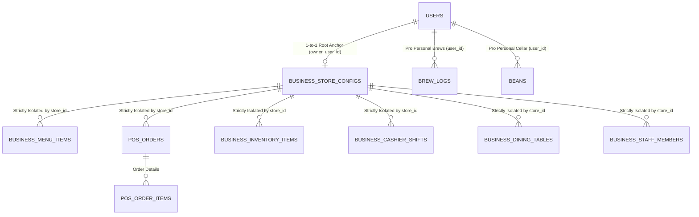

# System Design: Multi-Tenant Business Isolation & SOLID Architecture
**Coffee Labs Backend (Rust Axum & NeonDB PostgreSQL Serverless)**

---

## 1. Executive Summary & Core Objective
Sistem Coffee Labs melayani dua persona pengguna profesional utama dengan kebutuhan data yang sangat berbeda secara fundamental:
1. **Akun Pro (`AccountTier::Pro`)**: Home brewer, coffee enthusiast, dan roaster independen yang mencatat data personal (koleksi beans pribadi, jurnal seduh seduhan rumahan/V60, dial-in grind profile, dan resep personal).
2. **Akun Bisnis (`AccountTier::Business`)**: Pemilik kedai kopi, coffee shop chain, dan roastery komersial yang mengoperasikan kasir POS multi-barista, etalase tablet AOD/Kiosk pelanggan, stok bahan baku komersial (beans, susu, sirup, cup), rekonsiliasi shift kasir harian, tata letak meja (dine-in seating), dan analitik omzet.

**Prinsip Utama:**
> **Data antara setiap akun bisnis TIDAK BOLEH BERCAMPUR sedikit pun (Zero Cross-Tenant Leakage), dan data komersial bisnis terisolasi secara tegas dari data seduhan personal Pro.**

---

## 2. Model Isolasi Multi-Tenancy (Tenant Scoping Architecture)

### 2.1 Pola Isolasi: Shared Database, Tenant-Discriminator Foreign Keys
Menggunakan arsitektur multi-tenancy *Shared Process & Schema* dengan **Strict Tenant Scoping Discriminator** (`store_id UUID NOT NULL REFERENCES business_store_configs(id)`).

### 2.2 Boundary Matrix: Pro vs Business

| Dimensi Arsitektur | Mode Pro (`AccountTier::Pro`) | Mode Bisnis (`AccountTier::Business`) |
| :--- | :--- | :--- |
| **Karakter Data** | Personal, single-user, mobile lifestyle | Komersial, multi-staff, operasional kedai |
| **Tenant Root** | `user_id` pada tabel `users` | `store_id` pada `business_store_configs` |
| **Hak Akses Middleware** | `RequireTier<TierPro>` | `RequireTier<TierBusiness>` |
| **Entitas Utama** | `brew_logs`, `beans`, `recipes` | `business_inventory_items`, `business_cashier_shifts`, `business_dining_tables`, `business_staff_members`, `pos_orders` |
| **Keamanan Kasir/Kiosk** | Tidak ada | Cashier PIN (Argon2id), Emergency Master Token, Kiosk Hardware Lock |
| **Tingkat Akses Meja & Kas** | Tidak ada | Shift register, Opening cash, Cash variance, Table seating layout |

---

## 3. Penerapan Prinsip SOLID

### 3.1 Single Responsibility Principle (SRP)
Modul bisnis dipecah menjadi domain-domain kecil terisolasi:
- `tenant_context.rs`: Khusus mengonversi identitas pengguna JWT menjadi jangkar tenant store resmi.
- `inventory_*`: Mengelola stok fisik bahan baku (beans, susu, sirup), minimum alert level, dan penyesuaian kuantitas.
- `shift_*`: Mengelola buka-tutup shift kasir, uang modal awal, rekonsiliasi kas riil, dan selisih kas.
- `table_*`: Mengatur tata ruang meja (Indoor Bar, Patio, Mezzanine) dan token QR pesanan.
- `staff_*`: Mengelola akun staf barista kedai, role jabatan, dan PIN otorisasi transaksi.
- `analytics_*`: Agregasi omzet harian/bulanan, average order value, dan produk terlaris.
- `kiosk_*`: Menangani heartbeat telemetri hardware, locking, dan remote emergency recovery PIN.

### 3.2 Open/Closed Principle (OCP)
Setiap domain dapat diperluas (misalnya penambahan kategori bahan baku baru atau metode pembayaran baru) tanpa mengubah query dasar tenant context atau memodifikasi tabel domain lainnya.

### 3.3 Liskov Substitution Principle (LSP)
Seluruh respons controller mengembalikan kontrak standar `ApiResponse<T>` dengan mapping error seragam via `AppResult<Json<ApiResponse<T>>>`.

### 3.4 Interface Segregation Principle (ISP)
DTO dirancang granular dan fokus per kebutuhan spesifik (misalnya `OpenShiftDto` hanya berisi modal kas & nama shift, terpisah dari `CloseShiftDto` yang berisi uang fisik aktual).

### 3.5 Dependency Inversion Principle (DIP)
Handler Axum tidak bergantung pada query SQL mentah; seluruh logika data didelegasikan ke Repository terpusat yang menerima `&PgPool` dan `store_id` yang terverifikasi.

---

## 4. Matriks Endpoint API Mode Bisnis Terisolasi

| Method | Endpoint Path | Fungsi Layanan Bisnis |
| :--- | :--- | :--- |
| `GET` | `/api/v1/business/config` | Profil konfigurasi toko & tema AOD |
| `PUT` | `/api/v1/business/config` | Update pengaturan toko & PIN kasir |
| `GET` | `/api/v1/business/inventory` | Daftar inventori bahan baku (filter per kategori) |
| `POST` | `/api/v1/business/inventory` | Tambah bahan baku baru ke stok kedai |
| `PATCH`| `/api/v1/business/inventory/{id}/stock` | Sesuaikan kuantitas stok (+ restock / - pemakaian) |
| `DELETE`| `/api/v1/business/inventory/{id}` | Hapus item inventori |
| `GET` | `/api/v1/business/shifts/current` | Cek status shift kasir aktif saat ini |
| `POST` | `/api/v1/business/shifts/open` | Buka shift kasir dengan uang modal awal |
| `POST` | `/api/v1/business/shifts/{id}/close` | Tutup shift kasir & rekonsiliasi selisih kas |
| `GET` | `/api/v1/business/shifts/history` | Riwayat audit shift kasir masa lalu |
| `GET` | `/api/v1/business/tables` | Daftar tata letak meja kedai |
| `POST` | `/api/v1/business/tables` | Tambah meja / seating baru |
| `PATCH`| `/api/v1/business/tables/{id}/status` | Update status meja (available, occupied, reserved) |
| `DELETE`| `/api/v1/business/tables/{id}` | Hapus meja |
| `GET` | `/api/v1/business/staff` | Daftar tim barista kedai |
| `POST` | `/api/v1/business/staff` | Daftarkan barista baru dengan hak akses & PIN |
| `PATCH`| `/api/v1/business/staff/{id}` | Edit jabatan & izin staf |
| `DELETE`| `/api/v1/business/staff/{id}` | Nonaktifkan / hapus staf |
| `GET` | `/api/v1/business/analytics/summary` | Ringkasan omzet, AOV, low stock alert, & top menu |
| `POST` | `/api/v1/business/kiosk/heartbeat` | Heartbeat telemetri tablet kasir AOD |
| `POST` | `/api/v1/business/kiosk/emergency-unlock` | Permintaan pembukaan darurat kiosk remote |
| `GET` | `/api/v1/business/kiosk/recovery-pin` | 6-digit Time-Window Master Recovery PIN |
